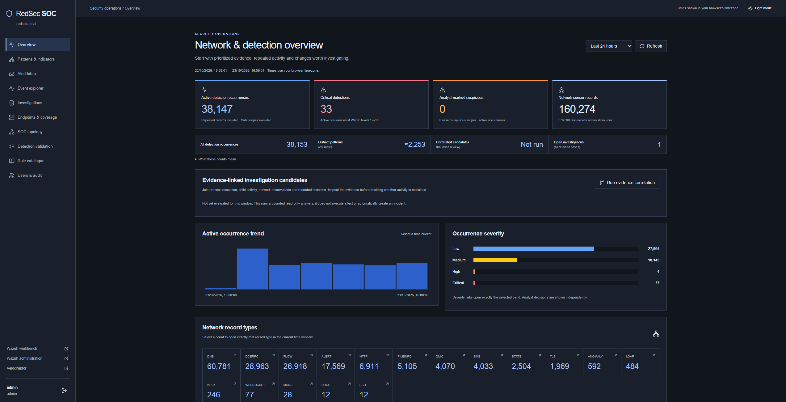
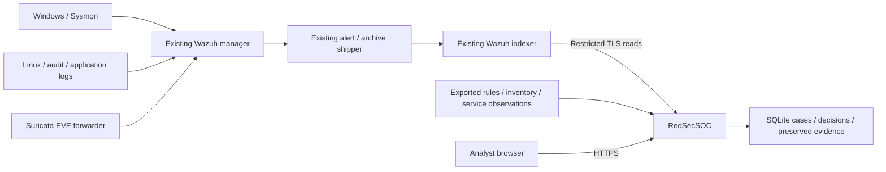

# RedSecSOC

**Understand the evidence. Group the noise. Investigate the sequence.**

[](https://github.com/0xP1ckl3d/RedSecSOC/actions/workflows/ci.yml)


RedSecSOC is a self-hosted investigation console for an **existing Wazuh stack**. It turns indexed alerts and raw telemetry into readable evidence, recurring detection summaries, network observations and evidence-linked investigation candidates. Cases retain original source copies, digests and analyst history independently of telemetry retention.

It uses your existing indexer: no second search cluster or cloud AI dependency. The console never executes alert content or decoded scripts.

[Supported stack](#supported-stack) · [Features](#features) · [Setup](#setup) · [Usage](#usage) · [Validation](docs/VALIDATION.md)



*Overview from a configured deployment. Display labels and record counts depend on the environment.*

## Supported stack

The current integration targets **native Wazuh alert/archive documents** through the Wazuh indexer's OpenSearch-compatible APIs.

| Component / source | Current support |
| --- | --- |
| Wazuh manager / indexer / dashboard | Validated with **4.14.9**. Reads `wazuh-alerts-*` and `wazuh-archives-*` through the existing shipper. Other versions require compatible mappings and permissions and are not independently certified. |
| Windows through Wazuh | Sysmon process, network, file, registry and DNS evidence; PowerShell scripts; Security authentication; available WMI, task and WinRM records. Correlation depends on the GUID/session fields actually collected. |
| Linux / applications through Wazuh | Audit, file integrity, configuration findings, decoded application records and container lifecycle/image evidence. Unknown fields remain available in the source; interpretation depth varies by source. |
| Suricata EVE through Wazuh | Alert, flow and protocol-specific records, including DNS, TLS, HTTP, SMB and Kerberos where present. Validated with **Suricata 8.0.7**. Addresses, ports, recorded names and provenance remain visible. |
| Velociraptor | Optional link to its separate UI. Hunt results and forensic collections are **not ingested or controlled** by this console. |
| Hosting | Installer validated on **Ubuntu 24.04**, Python **3.12**, systemd and TLS. Remote indexers are configurable. No Docker/Kubernetes deployment packaging is currently provided. |
| Other SIEMs | No generic Elastic Security, Splunk, Sentinel, Security Onion or arbitrary OpenSearch-schema adapter is provided. |

Raw archive ingestion must already be enabled for historical searches, rich timelines and correlation. Alerts alone give a smaller investigation view. Installing this console does not install Wazuh, deploy agents, configure a mirror/TAP or enable missing event sources.

## Features

- **Overview:** clickable time/severity charts and record-type counts, collection freshness, and separate counts for detection occurrences, estimated distinct patterns, bounded correlation candidates and analyst investigations.
- **Readable evidence:** affected executable, command, script, file, account, container image and network context where recorded; installed-rule explanations, field provenance and explicit gaps.
- **Triage:** assignments, notes, single/bulk clearing and reversible clear actions. Original detection severity and source events are retained.
- **Event explorer:** partial case-insensitive evidence search; time/host/severity/disposition/assessment filters; dedicated network logs with protocol, port and endpoint filters. Back retains filters, pagination and scroll.
- **Recurring patterns:** full-window rule summaries with nested host/file/signature/check breakdowns and sampled stable-activity detail.
- **Network review:** flow/byte/source concentration, observed names and services, retained ports and explicit IP categories. Its independent time slider defaults to 24 hours and supports exact From/To ranges.
- **Safe/Suspicious decisions:** narrow, audited, revocable future-match scopes. Whole-rule Safe decisions are rejected; missing/changed conditions stay visible. Suspicious overrides Safe.
- **Evidence correlation:** host-scoped process GUIDs, parent/child relationships, sessions and compatible flow observations; bounded forward retrieval and candidate cross-host session links with inspectable source fields/values.
- **Investigations:** explicit preservation of linked sequences or individual events, original JSON, SHA-256 digests, owners, dispositions, findings, export and history.
- **Coverage and topology:** registration, reporting and actual source observations are distinct; configured architecture and timestamped service observations are labelled separately.
- **Access and appearance:** local administrator/analyst/viewer roles, authenticated sessions, CSRF protection and optional dark mode.

## Architecture



The web service runs unprivileged. An optional local metadata exporter reads manager-host metadata. Addresses, credentials, service links, topology and approved asset aliases live in external configuration, not application code. [Topology details](docs/TOPOLOGY.md)

## Setup

Prerequisites: an existing compatible Wazuh stack, restricted indexer read account, trusted indexer CA, server TLS certificate/key, Python 3.12+ with `venv`, OpenSSL and **Node.js 24** for building. Node is not required by the running service.

### 1. Download and build

On the Ubuntu console host, use a source path without spaces:

```sh
sudo apt-get update
sudo apt-get install -y git python3-venv openssl
sudo install -d -o "$USER" /opt/redsec-soc-console
git clone https://github.com/0xP1ckl3d/RedSecSOC.git /opt/redsec-soc-console
cd /opt/redsec-soc-console
npm --prefix frontend ci
npm --prefix frontend test
npm --prefix frontend run build
```

### 2. Configure your deployment

```sh
sudo install -d -m 0755 /etc/redsec-soc-console
sudo install -m 0600 deploy/config.example.json /etc/redsec-soc-console/config.json
sudo install -m 0644 deploy/topology.example.json /etc/redsec-soc-console/topology.json
sudoedit /etc/redsec-soc-console/config.json
```

| Setting | Your value |
| --- | --- |
| `indexer_url`, `indexer_ca`, `indexer_user`, `indexer_password` | TLS indexer address, trusted CA path and a dedicated alert/archive read account. Keep administrator credentials away from the web service. |
| `listen_host`, `listen_port` | Intended interface and HTTPS port. The example binds to loopback; change it for direct internal access or configure your own reverse proxy. |
| `origins` | Exact browser HTTPS origin, including a non-default port, e.g. `https://soc.example.test:8443`. |
| `tls_cert`, `tls_key` | Existing server certificate/key paths. The certificate SAN must contain the browser hostname/IP. |
| `site_label`, `links`, `topology_file`, `asset_aliases_file` | Your display label, optional service links and external topology/asset metadata. |
| `local_metadata`, `wazuh_home`, `observed_units` | Enable local export only on the appropriate manager host. For a separate console host, set `local_metadata` to `false` and provide trusted exports if needed. |

Keep the example database, metadata and frontend paths unless deliberately changing them. The installer validates required files, rejects the placeholder password, verifies indexer TLS and does not modify firewall policy.

Need an indexer account? The [installation guide](docs/INSTALL.md#2-restricted-indexer-account) explains the explicit certificate-based provisioning helper. Its secret output stays outside Git.

### 3. Install and create your login

```sh
cd /opt/redsec-soc-console
sudo bash deploy/install.sh
sudo /opt/redsec-soc-console/venv/bin/python deploy/init_admin.py
sudo systemctl status redsec-soc-console --no-pager
```

The administrator helper prompts for credentials; no default password is shipped. Open your configured HTTPS URL, sign in and check **Endpoints & coverage** against a known recent event.

The installer creates the service account, pinned Python environment and metadata/certificate timers. Rerunning it preserves existing accounts, settings, cases and evidence and restarts this console only. Current limits are 512 MB maximum / 384 MB high memory, 150% CPU quota and bounded indexer queries; these are limits, not workload-sizing guarantees.

For TLS renewal, remote metadata, verification, updates and uninstalling, see [the complete installation guide](docs/INSTALL.md).

## Usage

1. **Start at Overview.** Occurrences count repeated records, not incidents. Select a severity, time bucket or protocol-record count to inspect matching records.
2. **Set the network window beside its table.** Default last 24 hours; drag to 15 minutes–48 hours and release to apply, or set exact UTC dates. Existing results stay visible while updating and the results area retains its height. The caption shows the actual range and drill-through links retain it.
3. **Filter Patterns & indicators.** Apply host/collector, rule, severity, disposition, assessment, protocol, port, endpoint or custom time filters. Expand a summary before reviewing occurrences. Destination summaries use flow records, not every protocol record. Their adjacent time slider and exact-range inputs share the page time filter, default to the last 24 hours, and preserve the displayed result window on drill-through.
4. **Inspect the evidence.** Verify the file/script/process, recorded user and source fields. Missing data stays explicit; a filename or high severity alone does not prove compromise.
5. **Record a scoped decision.** Safe needs specific recorded conditions. A PowerShell policy-test exemption does not cover a different executable dropped in the directory. Changed conditions stay visible with a badge and filter. Include Safe to review dismissed matches or revoke a saved scope.
6. **Follow the sequence.** Run evidence correlation to review a bounded sample of process seeds. A candidate opens in Evidence links. Inspect both records and the matched values; shared IP/time context alone never forms an edge.
7. **Preserve an investigation.** Save a linked sequence or pin individual events, assign an owner, record findings and verify/export source copies. Larger sequences require narrowing the context window.
8. **Check visibility.** A connected agent does not prove every source is enabled. Topology is operator-configured, with runtime observations and their timestamps shown separately.

## Interpretation limits

Correlation does not automatically declare confirmed incidents or guarantee remote execution attribution. Builtin sessions, reused PIDs, mismatched hosts/GUIDs and incompatible network times do not establish links. Missing records, NAT, clock skew, host restarts and retention can prevent reconstruction. A full independent attack-sequence validation remains an outstanding milestone.

Traffic volume and public infrastructure are not maliciousness verdicts. HTTP Host/TLS SNI are observed requested names, not proof of IP ownership. Multicast, private, loopback, link-local, shared and special-purpose ranges are distinct from public unicast. Safe scopes classify exact matching records, not an entire process/session as trustworthy.

The console does not deploy agents, launch tests, capture packets, ingest Velociraptor collections, administer Wazuh rules, modify source events, block traffic or synchronize external case plugins.

Read [Correlation and count semantics](docs/CORRELATION.md), [Investigation semantics](docs/INVESTIGATION.md), [Validation](docs/VALIDATION.md) and [Security](SECURITY.md).

## Development

```sh
python3 -m unittest discover -s tests -v
python3 tools/check_source.py
cd frontend
npm ci
npm test
npm run build
```

Backend tests use synthetic records. Frontend tests render React components with mocked responses; they do not contact a SOC or launch a browser. CI runs both suites, the build and publication checks. Dependencies are pinned in `backend/requirements.lock.txt` and `frontend/package-lock.json`.

Use `REDSEC_CONFIG` for a dedicated external development configuration. Runtime settings, certificates/keys, databases, evidence exports, build assets and dependencies are ignored by Git. Review staged files and run the source check before publishing; scanning supplements manual review.

See [Changelog](CHANGELOG.md). A distribution license has not yet been selected by the repository owner.
